<p align="center">
  <picture>
    <source media="(prefers-color-scheme: light)" srcset="docs/icon-light.png">
    
  </picture>
</p>

# Glyph Countdown

A countdown timer for the **Nothing Phone (3)** and **Phone (4a) Pro** that shows the time left
on the phone's rear Glyph Matrix. Set the time by dragging a dot around a ring of tick marks, flip the phone
face-down to start, and watch the countdown on the back.

> **Unofficial app.** Not made, endorsed or supported by Nothing Technology Limited.
> See [Trademarks](#trademarks).

## Design

<p align="center">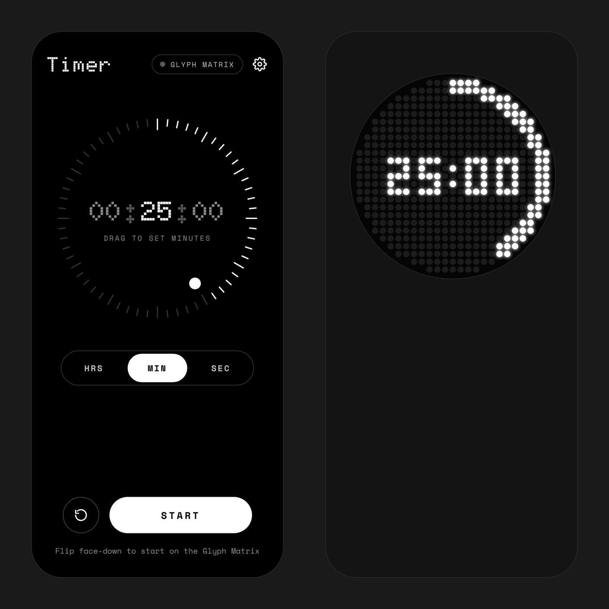</p>
<p align="center"><em>Timer screen and the matching Glyph Matrix display</em></p>

<p align="center">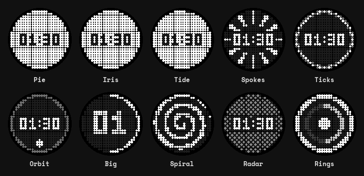</p>
<p align="center"><em>Countdown styles, drawn by the app's own code: pick one, or keep the original ring</em></p>

<p align="center">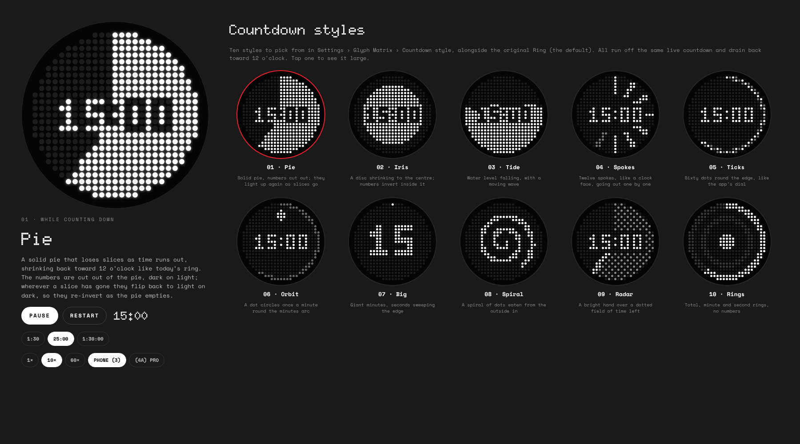</p>
<p align="center"><em>Settings › Glyph Matrix › Countdown style. In Pie, the numbers are cut out of the pie and light up again as slices go</em></p>

<p align="center">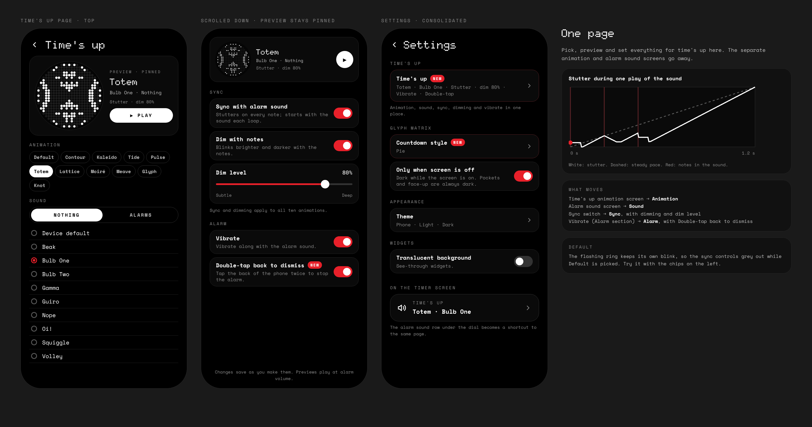</p>
<p align="center"><em>The Time's up page: animation, sound, sync, dimming and vibrate in one place, with a live preview</em></p>

<p align="center">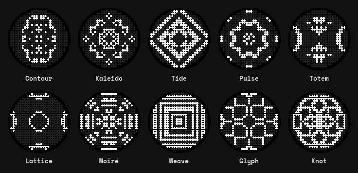</p>
<p align="center"><em>Time's-up animations, drawn by the app's own animation code</em></p>

<p align="center">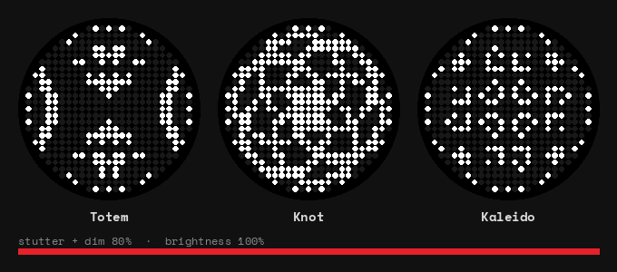</p>
<p align="center"><em>Stutter sync with dimming at 80%: the animation jerks back on every note and blinks with the sound (drawn by the app's own code)</em></p>

<p align="center">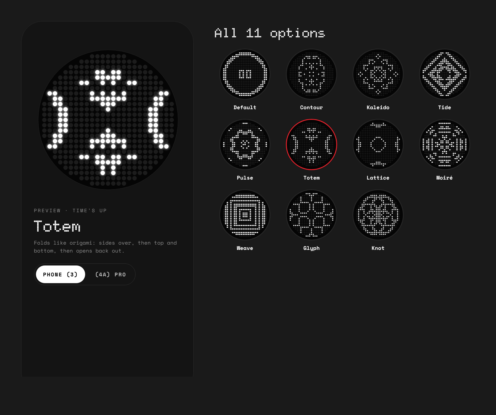</p>
<p align="center"><em>All eleven time's-up options, on the Phone (3) or Phone (4a) Pro matrix</em></p>

<p align="center">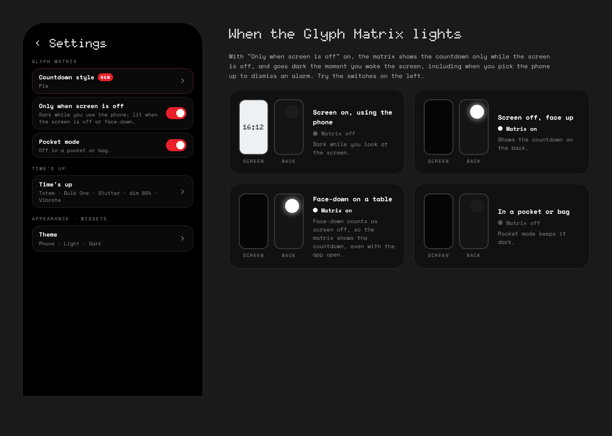</p>
<p align="center"><em>When the Glyph Matrix lights: face-down or in your hand, never in a pocket or face-up</em></p>

<p align="center">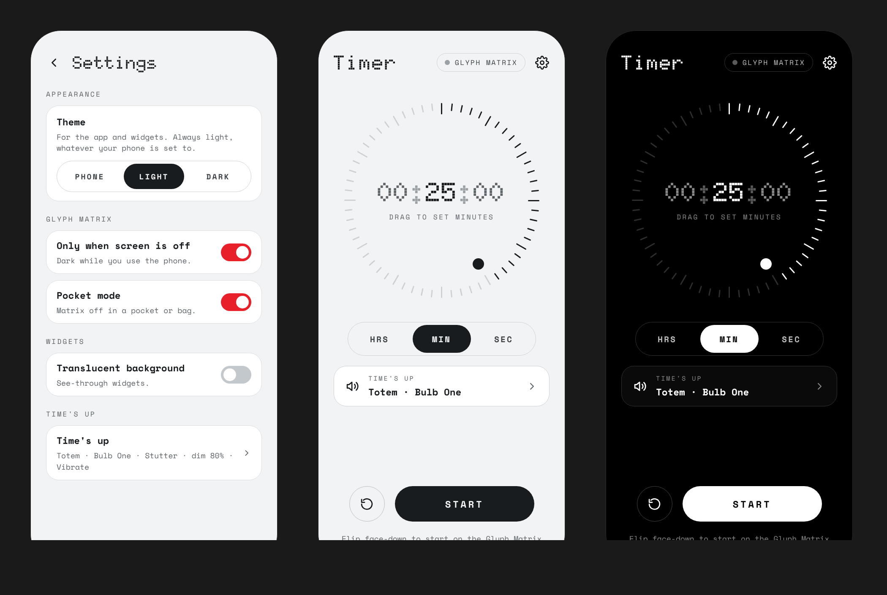</p>
<p align="center"><em>Settings › Theme (Phone, Light or Dark), and the timer screen in light and dark</em></p>

<p align="center">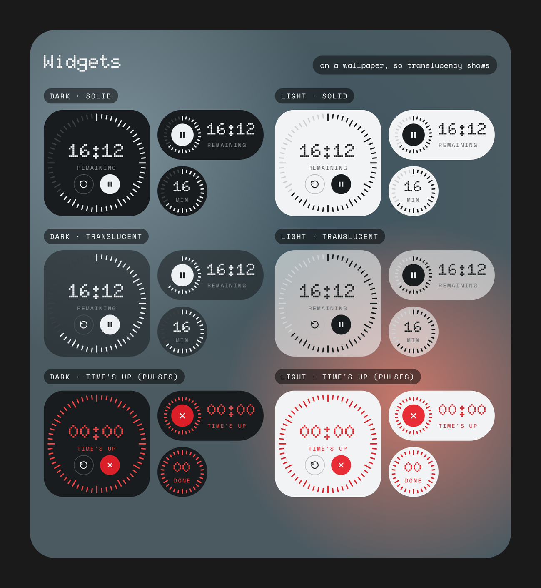</p>
<p align="center"><em>Widgets in dark, light, translucent and time's-up states</em></p>

<p align="center">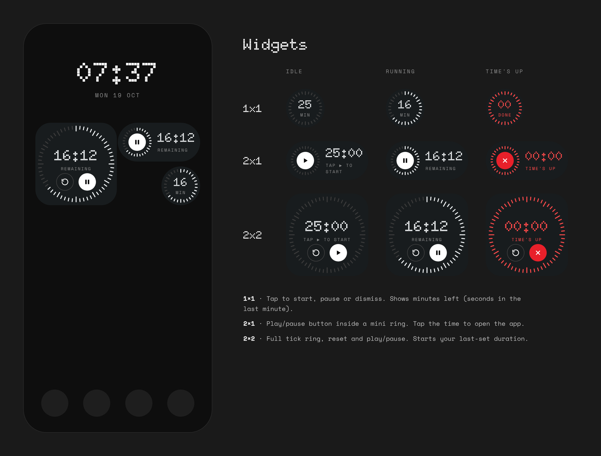</p>
<p align="center"><em>Widgets on the home screen, and each size idle, running and at time's up</em></p>

<p align="center">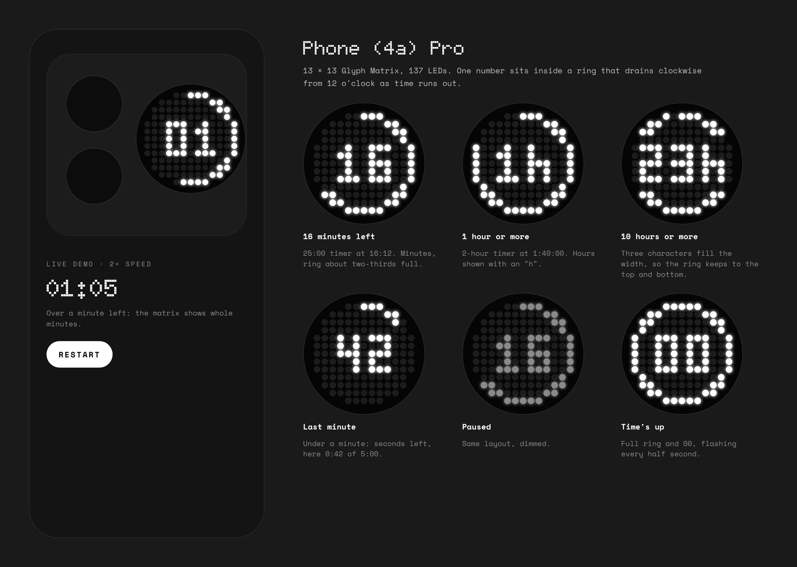</p>
<p align="center"><em>Phone (4a) Pro: the 13 × 13 Glyph Matrix in each state</em></p>

These are the design mockups the app was built from. They use the open-source Doto font;
on a Nothing phone the app itself uses Nothing's NDot font, which can't be included here.

## Features

### Timer
- **Dial**: one dial sets hours, minutes or seconds. Pick the unit with HRS / MIN / SEC or by
  tapping the digits, then drag the dot round the tick ring, with a light haptic tick at each step.
  Up to 23 h 59 min 59 s.
- **Remembers your last time**, ready for next time (and for the widgets).
- **Flip to start**: with the app open, place the phone face-down to start. The matrix lights
  straight away, even with the screen still on. Always on.
- **Time's up shortcut** under the dial shows your animation and sound and opens the Time's up page.
- **Keeps running with the app closed**: a notification shows a live countdown with
  Pause / Resume / Reset buttons.
- **TalkBack**: the dial announces the time and can be adjusted by swiping up or down.

### Glyph Matrix
- While the timer runs, the rear display shows the time left inside a ring that drains
  clockwise. It dims when paused.
- **Countdown style**: keep that ring, or pick one of ten other styles, all with a live preview:
  - **Pie**: a solid pie with the numbers cut out of it; they light up again as slices go.
  - **Iris**: a disc shrinking to the centre.
  - **Tide**: a falling water level with a moving wave.
  - **Spokes**: twelve clock-face spokes going out one by one.
  - **Ticks**: sixty dots round the edge, with the last one blinking.
  - **Orbit**: a dot circling once a minute round the time-left arc.
  - **Big**: double-size minutes with the seconds sweeping the edge.
  - **Spiral**: a spiral eaten from the outside in, no numbers.
  - **Radar**: a bright hand over a dotted field of time left.
  - **Rings**: total, minute and second rings, no numbers.
  - **Phone (3)**, 25 × 25: H:MM from an hour up (the colon blinks each second), MM:SS below.
  - **Phone (4a) Pro**, 13 × 13: one number — hours ("2h"), minutes, or seconds in the last
    minute.
- **Lights only where you can see it**: the phone works out where it is from its sensors,
  with nothing to set up.
  - **Lit**: face-down on a table (even with the app open, so flip to start shows the
    countdown), or in your hand with the screen off.
  - **Dark**: while you use the screen, in a pocket or bag, and face-up on a table.
  - A table is the only place a phone lies flat and perfectly still, so a pocket is never
    mistaken for one, even when you're sitting down.
  - **Only when screen is off** (on by default) can be switched off to keep the matrix lit
    while you use the screen; pockets and face-up stay dark either way.

### Time's up
Everything that happens when the timer ends is set on one page (Settings › Time's up, or the
shortcut under the dial). A preview pinned at the top plays your choices together, with the real
sound, exactly as the alarm will. Changes save as you make them.

- **Animation**: the flashing ring (Default) or one of ten looping animations: Contour,
  Kaleido, Tide, Pulse, Totem (folds up like origami and opens out again), Lattice, Moiré,
  Weave, Glyph and Knot. All work on both matrix sizes.
- **Sound**: your phone's Nothing notification sounds or its alarm sounds. Picking one plays
  it with the animation. The alarm plays at alarm volume for up to 3 minutes or until dismissed.
- **Sync with alarm sound**: the animation plays through in full, starting with the sound each
  loop, and stutters on every note: it snaps back or rewinds, holds for a moment, then carries
  on. Can be switched off for a steady pace.
- **Dim with notes**: the matrix blinks with the sound, a flash with sparks round the edge on
  each note, then dimmer steps. Switch it off for stutter only at full brightness.
- **Dim level**: a slider from subtle to deep sets how dark it dims between notes.
- **Vibrate** along with the sound, which can be switched off.
- **Double-tap back to dismiss**: tap the back of the phone twice to stop the alarm, whichever
  way up it is: in your hand, or lying face down or face up on a table. It uses the motion
  sensor and ignores the alarm's own vibration. On by default; can be switched off.

### Widgets
Three sizes, shaped and coloured like Nothing's own widgets: a circle, a pill and a rounded
square. They update every second while the timer runs, pulse red when time's up, and start the
duration you last set in the app.

| 1 × 1 | 2 × 1 | 2 × 2 |
|:-:|:-:|:-:|
| 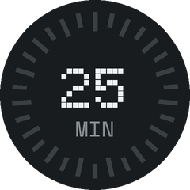 | 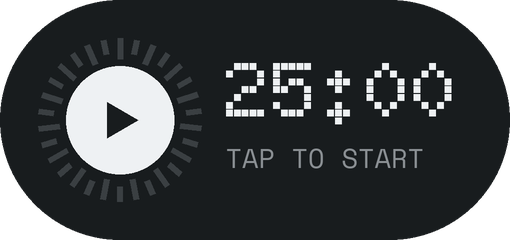 | 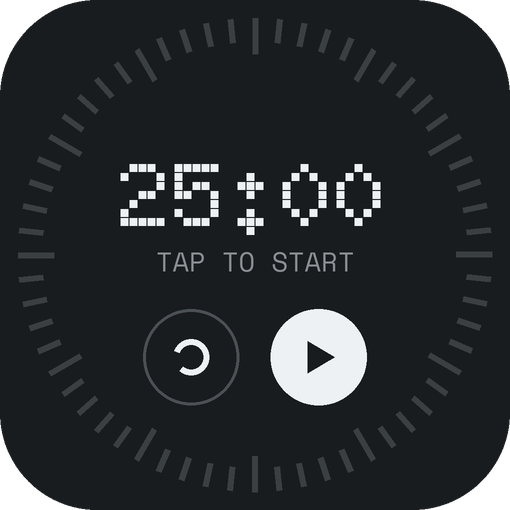 |
| Tap to start, pause or dismiss | Button starts/pauses; time opens the app | Reset and play/pause buttons |

- **Translucent background** option, for see-through widgets.

### Look and feel
- **Light and dark themes** for the app and widgets: follow the phone's Display › Appearance,
  or pick Light or Dark regardless of the phone.
- **App icon**: twelve clock spokes with a red centre, light or dark to match Dark mode, and a
  single-colour version for themed icons.
- **NDot font**: on Nothing phones the app uses the NDot font already installed on the phone,
  so it matches the rest of Nothing OS. Elsewhere it uses the open-source Doto font.

### Settings
Tap the gear on the timer screen:

| Section | Options |
|---|---|
| Time's up | Opens the Time's up page: animation, sound, sync, dimming, dim level, vibrate, double-tap to dismiss |
| Glyph Matrix | Countdown style · Only when screen is off |
| Appearance | Theme: Phone, Light or Dark |
| Widgets | Translucent background |

## Install

1. Download `GlyphCountdown-*.apk` from [Releases](../../releases).
2. Optionally check it: the release notes list the APK's SHA-256 and the signing
   certificate's fingerprint, which is the same for every release.
3. Open it on your phone and allow **Install unknown apps** when Android asks.
4. On first start, allow notifications.

Requires Android 13 or newer. The Glyph Matrix needs a Nothing Phone (3) or Phone (4a) Pro; on
other phones the timer, sounds and widgets still work.

**Adding widgets:** long-press the home screen → Widgets → Glyph Countdown.

**Settings:** tap the gear on the timer screen (see [Settings](#settings)).

### Known limits

- Pressing the Glyph Button on the back opens Nothing's toy carousel, which takes the matrix
  over from apps. The timer comes back when the carousel closes or you reopen the app. Apps
  can't see Glyph Button presses, so to dismiss the alarm from the back, double-tap the phone.
- Google Clock's own alarm sounds are private to that app, so only sounds installed on the
  phone itself are listed.
- Face-down start only works while the app is open on screen.

## Build it yourself

No Android Studio or Gradle needed: just `git`, a JDK (17+) and `python3`.

```sh
./setup-deps.sh                      # once: downloads and compiles the build tools (~50 MB)
KEYSTORE_PASS='choose-a-password' ./build.sh
# → out/GlyphCountdown.apk
```

A local build signs with `release.jks` (or wherever `KEYSTORE` points), creating a key there
if none exists. That's for your own testing: phones won't accept it as an update to the
official releases, which are signed with the project's key.

Every build tool is pinned to an exact commit, and `android.jar` and the Glyph SDK are checked
against SHA-256 hashes, so a changed dependency fails the build instead of slipping in.

`setup-deps.sh` downloads Nothing's Glyph Matrix SDK from
[Nothing's repository](https://github.com/Nothing-Developer-Programme/GlyphMatrix-Developer-Kit).
The SDK's licence allows using it in your own app but not redistributing it, so it is
not included in this repository.

### Releases

Releases are built and signed by GitHub Actions, never on a personal machine:

- **Build check** (`.github/workflows/ci.yml`): every push and pull request is built with a
  throwaway key, so a broken build is caught early.
- **Release** (`.github/workflows/release.yml`): on every push to `main` it checks
  `versionName` in the manifest. If that version has no release yet, it builds that exact
  commit, signs it with the key stored in the repository's encrypted secrets
  (`KEYSTORE_BASE64`, `KEYSTORE_PASS`), and publishes release `v<versionName>` (creating the
  tag) with the APK, its SHA-256 and the certificate fingerprint. Release notes come from
  `docs/release-notes/v<versionName>.md`. Pushing a `v*` tag by hand also works.

To release: bump `versionCode` and `versionName` in `app/AndroidManifest.xml`, add
`docs/release-notes/v1.5.md`, commit and push to `main`. No tag is needed.

### Project layout

| Path | What it is |
|---|---|
| `app/src/…/MainActivity.java` | Timer screen, face-down detection |
| `app/src/…/DialView.java` | The tick-ring dial and draggable dot |
| `app/src/…/TimerService.java` | Countdown, notification, alarm, Glyph Matrix |
| `app/src/…/MatrixRenderer.java` | Draws frames for the Glyph Matrix (25 × 25 and 13 × 13) |
| `app/src/…/MorphEngine.java` | The ten time's-up animations, for both matrix sizes |
| `app/src/…/CountdownStyles.java`, `CountdownStyleActivity.java` | The ten countdown styles and their picker |
| `app/src/…/BackTapDetector.java` | Double-tap on the back to dismiss the alarm |
| `app/src/…/Placement.java` | Works out where the phone is (table, hand, pocket) to light or darken the matrix |
| `app/src/…/SoundSync.java` | Reads the alarm sound's notes; stutter, dimming and the time's-up frame |
| `app/src/…/TimesUpActivity.java` | The Time's up page: animation, sound, sync, dimming, vibrate, live preview |
| `app/src/…/Sounds.java` | The phone's alarm and notification sound lists |
| `app/src/…/SettingsActivity.java`, `Prefs.java` | Settings screen and saved switches |
| `app/src/…/Palette.java` | Light and dark colours for the app; the theme choice |
| `app/src/…/Widget*.java` | Home screen widgets (light/dark via `res/layout-night`) |
| `tools/` | APK assembler, zip aligner, widget preview generator |
| `.github/workflows/` | Build check and signed release |

## Security

See [SECURITY.md](SECURITY.md) for how to report a problem and how releases are signed.

## Licence

The code in this repository is released under the [MIT Licence](LICENSE). It comes with
**no warranty**: you use it at your own risk.

Third-party components keep their own licences; see [THIRD-PARTY-NOTICES.md](THIRD-PARTY-NOTICES.md).

## Trademarks

Nothing, Phone (3) and Glyph are trademarks of Nothing Technology Limited. They are used
here only to say which device and feature this app works with. This project is not
affiliated with or endorsed by Nothing.
