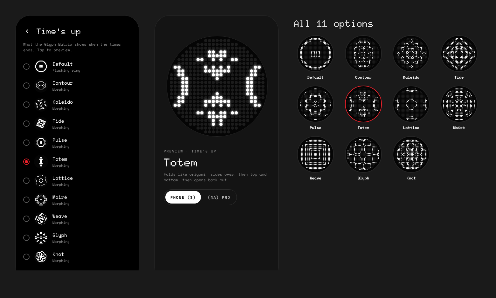
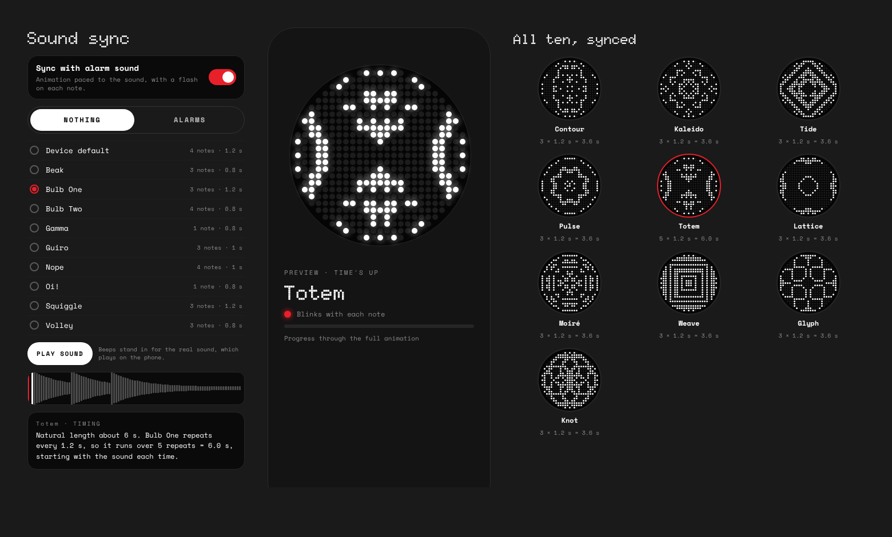
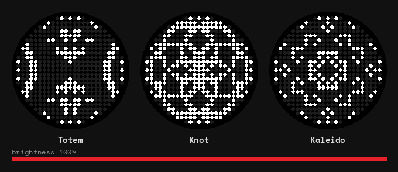
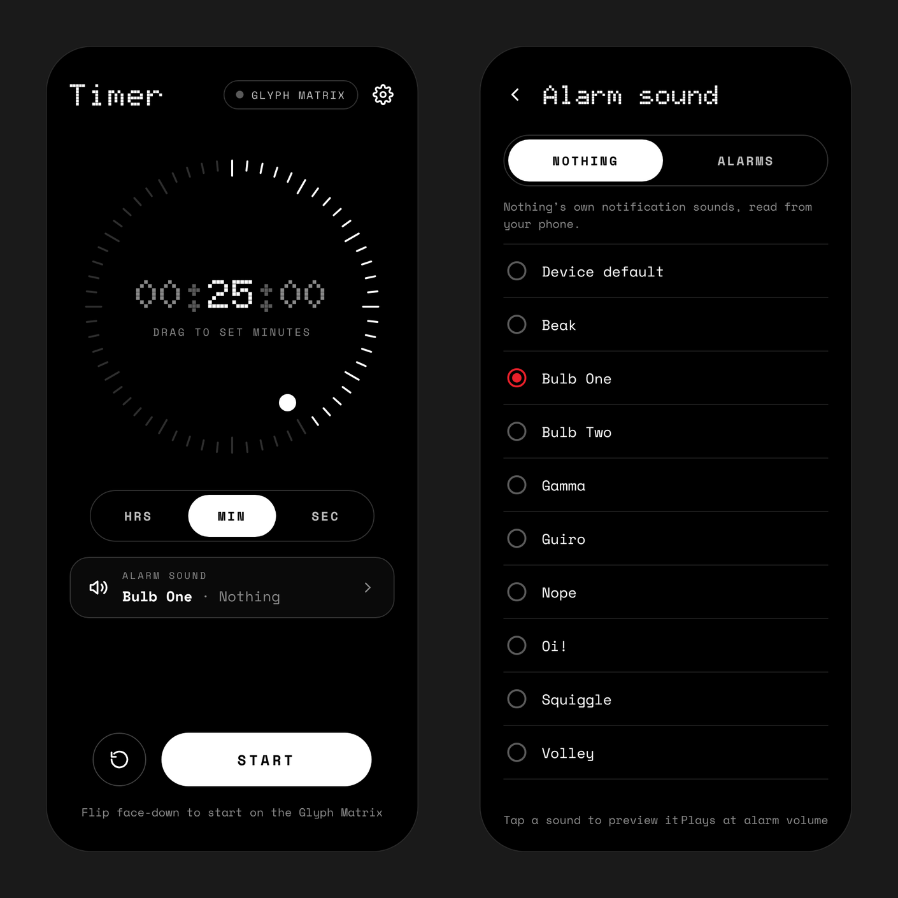

<p align="center"></p>

# Glyph Countdown

A countdown timer for the **Nothing Phone (3)** and **Phone (4a) Pro** that shows the time left
on the phone's rear Glyph Matrix. Set the time by dragging a dot around a ring of tick marks, flip the phone
face-down to start, and watch the countdown on the back.

> **Unofficial app.** Not made, endorsed or supported by Nothing Technology Limited.
> See [Trademarks](#trademarks).

## Design

<p align="center"></p>
<p align="center"><em>Timer screen and the matching Glyph Matrix display</em></p>

<p align="center"></p>
<p align="center"><em>Time's-up animations, drawn by the app's own animation code</em></p>

<p align="center"></p>
<p align="center"><em>Settings › Time's up animation, with live previews</em></p>

<p align="center"></p>
<p align="center"><em>Sound sync: each loop lines up with whole repeats of the alarm sound</em></p>

<p align="center"></p>
<p align="center"><em>With sync on, the matrix blinks through brightness levels on every note (drawn by the app's own code)</em></p>

<p align="center"></p>
<p align="center"><em>Only when screen is off: the matrix goes dark while you're using the phone</em></p>

<p align="center"></p>
<p align="center"><em>Alarm sound row and picker (the sound list is read from your phone)</em></p>

<p align="center"></p>
<p align="center"><em>Settings › Theme (Phone, Light or Dark), and the timer screen in light and dark</em></p>

<p align="center"></p>
<p align="center"><em>Widgets in dark, light, translucent and time's-up states</em></p>

<p align="center"></p>
<p align="center"><em>Widgets on the home screen, and each size idle, running and at time's up</em></p>

<p align="center"></p>
<p align="center"><em>Phone (4a) Pro: the 13 × 13 Glyph Matrix in each state</em></p>

These are the design mockups the app was built from. They use the open-source Doto font;
on a Nothing phone the app itself uses Nothing's NDot font, which can't be included here.

## Features

### Timer
- **Dial**: one dial sets hours, minutes or seconds. Pick the unit with HRS / MIN / SEC or by
  tapping the digits, then drag the dot round the tick ring, with a light haptic tick at each step.
  Up to 23 h 59 min 59 s.
- **Remembers your last time**, ready for next time (and for the widgets).
- **Flip to start**: with the app open, place the phone face-down to start. Always on.
- **Keeps running with the app closed**: a notification shows a live countdown with
  Pause / Resume / Reset buttons.
- **TalkBack**: the dial announces the time and can be adjusted by swiping up or down.

### Glyph Matrix
- While the timer runs, the rear display shows the time left inside a ring that drains
  clockwise. It dims when paused.
  - **Phone (3)**, 25 × 25: H:MM from an hour up (the colon blinks each second), MM:SS below.
  - **Phone (4a) Pro**, 13 × 13: one number — hours ("2h"), minutes, or seconds in the last
    minute.
- **Time's-up animations**: pick what the matrix shows when the timer ends: the flashing
  ring (Default) or one of ten looping animations: Contour, Kaleido, Tide, Pulse, Totem
  (folds up like origami and opens out again), Lattice, Moiré, Weave, Glyph and Knot. Each
  has a live preview, and all of them work on both matrix sizes.
- **Sync with alarm sound**: the animation is paced to your alarm sound so each loop starts
  with it, and it blinks with every note: a full-brightness flash with sparks round the edge,
  then dimmer steps, then a brief dark gap before the next note. Notes flash at different
  strengths. Works with all the Nothing and alarm sounds; can be switched off.
- **Only when screen is off**: the matrix goes dark while you're using the phone and lights
  when the screen is off. Face-down counts as off, so flip to start shows the countdown
  even with the app open. On by default; switch it off to keep the matrix lit all the time.
- **Pocket mode**: the matrix turns off while the phone is in a pocket or bag and comes back
  when you take it out. Face-down on a table still shows it.

### Alarm
- **Choose the sound**: your phone's Nothing notification sounds or its alarm sounds, with a
  preview. It plays at alarm volume and repeats for up to 3 minutes or until dismissed.
- **Vibration** along with the sound, which can be switched off.

### Widgets
Three sizes, shaped and coloured like Nothing's own widgets: a circle, a pill and a rounded
square. They update every second while the timer runs, pulse red when time's up, and start the
duration you last set in the app.

| 1 × 1 | 2 × 1 | 2 × 2 |
|:-:|:-:|:-:|
|  |  |  |
| Tap to start, pause or dismiss | Button starts/pauses; time opens the app | Reset and play/pause buttons |

- **Translucent background** option, for see-through widgets.

### Look and feel
- **Light and dark themes** for the app and widgets: follow the phone's Display › Appearance,
  or pick Light or Dark regardless of the phone.
- **NDot font**: on Nothing phones the app uses the NDot font already installed on the phone,
  so it matches the rest of Nothing OS. Elsewhere it uses the open-source Doto font.

### Settings
Tap the gear on the timer screen:

| Section | Options |
|---|---|
| Appearance | Theme: Phone, Light or Dark |
| Glyph Matrix | Only when screen is off · Pocket mode · Time's up animation · Sync with alarm sound |
| Widgets | Translucent background |
| Alarm | Alarm sound · Vibrate |

## Install

1. Download `GlyphCountdown-*.apk` from [Releases](../../releases).
2. Optionally check it: the release notes list the APK's SHA-256 and the signing
   certificate's fingerprint, which is the same for every release.
3. Open it on your phone and allow **Install unknown apps** when Android asks.
4. On first start, allow notifications.

Requires Android 13 or newer. The Glyph Matrix needs a Nothing Phone (3) or Phone (4a) Pro; on
other phones the timer, sounds and widgets still work.

**Adding widgets:** long-press the home screen → Widgets → Glyph Countdown.

**Settings:** tap the gear on the timer screen (see [Settings](#settings)).

### Known limits

- Pressing the Glyph Button on the back opens Nothing's toy carousel, which takes the matrix
  over from apps. The timer comes back when the carousel closes or you reopen the app.
- Google Clock's own alarm sounds are private to that app, so only sounds installed on the
  phone itself are listed.
- Face-down start only works while the app is open on screen.

## Build it yourself

No Android Studio or Gradle needed: just `git`, a JDK (17+) and `python3`.

```sh
./setup-deps.sh                      # once: downloads and compiles the build tools (~50 MB)
KEYSTORE_PASS='choose-a-password' ./build.sh
# → out/GlyphCountdown.apk
```

A local build signs with `release.jks` (or wherever `KEYSTORE` points), creating a key there
if none exists. That's for your own testing: phones won't accept it as an update to the
official releases, which are signed with the project's key.

Every build tool is pinned to an exact commit, and `android.jar` and the Glyph SDK are checked
against SHA-256 hashes, so a changed dependency fails the build instead of slipping in.

`setup-deps.sh` downloads Nothing's Glyph Matrix SDK from
[Nothing's repository](https://github.com/Nothing-Developer-Programme/GlyphMatrix-Developer-Kit).
The SDK's licence allows using it in your own app but not redistributing it, so it is
not included in this repository.

### Releases

Releases are built and signed by GitHub Actions, never on a personal machine:

- **Build check** (`.github/workflows/ci.yml`): every push and pull request is built with a
  throwaway key, so a broken build is caught early.
- **Release** (`.github/workflows/release.yml`): pushing a tag such as `v1.0` builds that exact
  commit, signs it with the key stored in the repository's encrypted secrets
  (`KEYSTORE_BASE64`, `KEYSTORE_PASS`), and publishes the release with the APK, its SHA-256
  and the certificate fingerprint. The tag must match `versionName` in the manifest, and
  release notes come from `docs/release-notes/<tag>.md`.

To release: bump `versionCode` and `versionName` in `app/AndroidManifest.xml`, add the notes
file, commit, then `git tag v1.3 && git push origin v1.3`.

### Project layout

| Path | What it is |
|---|---|
| `app/src/…/MainActivity.java` | Timer screen, face-down detection |
| `app/src/…/DialView.java` | The tick-ring dial and draggable dot |
| `app/src/…/TimerService.java` | Countdown, notification, alarm, Glyph Matrix |
| `app/src/…/MatrixRenderer.java` | Draws frames for the Glyph Matrix (25 × 25 and 13 × 13) |
| `app/src/…/MorphEngine.java` | The ten time's-up animations, for both matrix sizes |
| `app/src/…/SoundSync.java` | Reads the alarm sound's length and notes to pace the animation |
| `app/src/…/TimesUpActivity.java` | Time's-up animation picker with live previews |
| `app/src/…/SoundActivity.java`, `Sounds.java` | Alarm sound picker |
| `app/src/…/SettingsActivity.java`, `Prefs.java` | Settings screen and saved switches |
| `app/src/…/Palette.java` | Light and dark colours for the app; the theme choice |
| `app/src/…/Widget*.java` | Home screen widgets (light/dark via `res/layout-night`) |
| `tools/` | APK assembler, zip aligner, widget preview generator |
| `.github/workflows/` | Build check and signed release |

## Security

See [SECURITY.md](SECURITY.md) for how to report a problem and how releases are signed.

## Licence

The code in this repository is released under the [MIT Licence](LICENSE). It comes with
**no warranty**: you use it at your own risk.

Third-party components keep their own licences; see [THIRD-PARTY-NOTICES.md](THIRD-PARTY-NOTICES.md).

## Trademarks

Nothing, Phone (3) and Glyph are trademarks of Nothing Technology Limited. They are used
here only to say which device and feature this app works with. This project is not
affiliated with or endorsed by Nothing.
